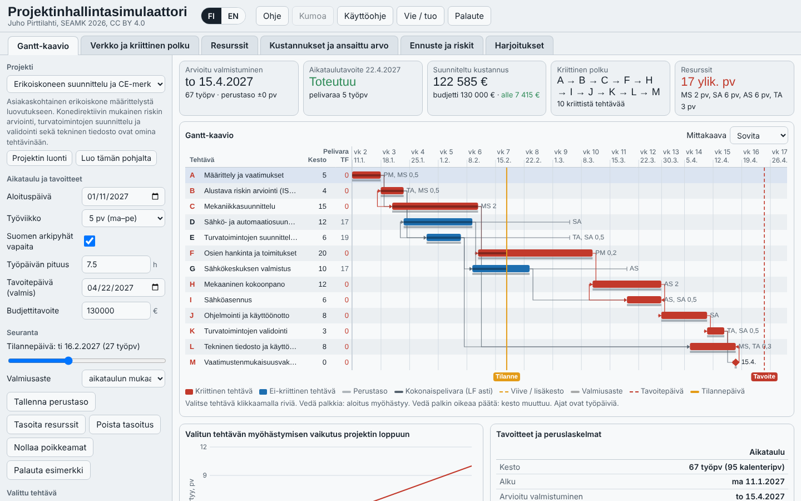

# Projektinhallintasimulaattori / Project Management Simulator

[](../../actions/workflows/validointi.yml)

Selaimessa toimiva opetussimulaattori projektin aikataulutukseen, resurssointiin, kustannusseurantaan ja ennustamiseen. Projektia hallitaan Gantt-kaaviona, ja simulaattori näyttää heti, miten yhden tehtävän myöhästyminen, resurssin puute tai kustannusylitys vaikuttaa koko projektiin.

**Kokeile:** <https://jipirtti.github.io/Projektinhallintasimulaattori/> tai avaa `index.html` suoraan selaimessa. Asennusta tai palvelinta ei tarvita.

**Kieli / Language / Sprache:** käyttöliittymä on suomeksi, englanniksi ja saksaksi. Kieltä vaihdetaan yläpalkin FI | EN | DE -valitsimella lennosta, ja valinta muistetaan selaimessa. Suora linkki: `?lang=en` tai `?lang=de`. Käyttöohje: [suomeksi](https://jipirtti.github.io/Projektinhallintasimulaattori/docs/kayttoohje.html), [englanniksi](https://jipirtti.github.io/Projektinhallintasimulaattori/docs/user-manual.html), [saksaksi](https://jipirtti.github.io/Projektinhallintasimulaattori/docs/bedienungsanleitung.html). The user interface is available in Finnish, English and German (FI | EN | DE toggle, or `?lang=en` / `?lang=de`); [user manual in English](https://jipirtti.github.io/Projektinhallintasimulaattori/docs/user-manual.html). Die Oberfläche ist auf Finnisch, Englisch und Deutsch verfügbar (Umschalter FI | EN | DE oder `?lang=de`); [Bedienungsanleitung auf Deutsch](https://jipirtti.github.io/Projektinhallintasimulaattori/docs/bedienungsanleitung.html).

Tekijä: Juho Pirttilahti, Seinäjoen ammattikorkeakoulu (SEAMK), 2026. Suunnittelu, sisältö ja validointi: Juho Pirttilahti. Ohjelmakoodi toteutettu tekoälyavusteisesti (Claude, Anthropic). Lisenssi: [CC BY 4.0](LICENSE).



## Ominaisuudet

- **Gantt-kaavio:** kriittinen polku, perustaso, kokonaispelivara, valmiusaste, tavoite- ja tilannepäivä. Palkkia vetämällä tehtävän aloitus myöhästyy, oikeaa päätä vetämällä kesto muuttuu. Valitun tehtävän myöhästymisen vaikutus projektin loppuun kuvaajana.
- **Verkko ja kriittinen polku:** verkkokaavio (ES | kesto | EF / LS | TF | LF), riippuvuustyypit LA, AA, LL ja AL (FS, SS, FF, SF) viiveineen, kokonais- ja vapaa pelivara, PERT-arviot.
- **Resurssit:** kuormitus työpäivittäin, kapasiteetin ylitykset, resurssien tasoitus, muokattavat kapasiteetit ja tuntihinnat.
- **Kustannukset ja ansaittu arvo:** S-käyrä, PV, EV, AC, SV, CV, SPI, CPI, EAC (kolme laskentatapaa), ETC, VAC, TCPI sekä ansaittu aikataulu SPI(t) ja IEAC(t), sanallinen tulkinta.
- **Ennuste ja riskit:** Monte Carlo -simulointi kolmiojakaumalla (P10–P90, todennäköisyys pysyä tavoitteessa, kriittisyysindeksi) ja PERT.
- **Harjoitukset:** 10–13 automaattisesti tarkistettavaa tehtävää jokaiseen projektiin, myös seurantatilanne. Ratkaisu avautuu vasta, kun tehtävään on vastattu.
- **Oma projekti:** kuuden vaiheen kysely (projekti, kalenteri, tavoitteet, resurssit, tehtävät, yhteenveto), virheiden tarkistus ennen luontia, muokkaus ja vienti / tuonti.
- **Muuta:** viisi esimerkkiprojektia, Suomen arkipyhät kalenterissa, kumoa, ohjeikkuna, käyttöohje, Palaute-painike (GitHub-issue tai sähköposti), tumma teema ja mobiilinäkymä.

## Laskentamallit lyhyesti

| Osa | Malli |
| --- | --- |
| Aikataulu | Kriittisen polun menetelmä (CPM): eteenpäin- ja taaksepäinlaskenta, riippuvuudet LA/AA/LL/AL viiveineen |
| Kalenteri | Työpäivät; viikonloput ja valinnaisesti Suomen arkipyhät (pääsiäinen gregoriaanisella algoritmilla) |
| Kustannus | kesto × yksiköt × h/pv × €/h + kiinteä kustannus |
| Tasoitus | Sarjallinen ajoitus, prioriteettina myöhäisin alkamisaika |
| Ansaittu arvo | PV, EV, AC ja indeksit; valmiusaste tasaisena nykyisen aikataulun mukaan tai käsin; ansaittu aikataulu |
| Ennuste | PERT (tₑ = (O + 4M + P)/6, σ = (P − O)/6, normaalijakauma) ja Monte Carlo (kolmiojakauma, kiinteä siemenluku) |

Mallit, tarkistukset ja validointi: [VALIDOINTI.md](VALIDOINTI.md). Käyttöohje: [docs/kayttoohje.md](docs/kayttoohje.md).

## Validointi

`tests/` sisältää validointitestit V01–V12 sekä kieli-, käyttö- ja palautetestit (yhteensä 62 testiä). Aikataulu, pelivarat, kustannukset ja ansaittu arvo verrataan kaikissa esimerkeissä riippumattomaan Python-viitelaskentaan (`tests/viite.py`), joka ei käytä simulaattorin koodia; lisäksi osa arvoista on käsinlaskettu. GitHub Actions ajaa testit jokaisesta muutoksesta ja maanantaisin; julkaisu GitHub Pagesiin tapahtuu vain, jos validointi menee läpi.

```
pip install -r requirements-test.txt
python -m playwright install chromium
python -m pytest tests -v
```

## Kehitys ja palaute

Kehitysohjeet: [CONTRIBUTING.md](CONTRIBUTING.md). Palautteen voi antaa simulaattorin Palaute-painikkeella tai issue-malleilla. Muutokset: [CHANGELOG.md](CHANGELOG.md).

Kaikki simulaattorit: <https://jipirtti.github.io/>
