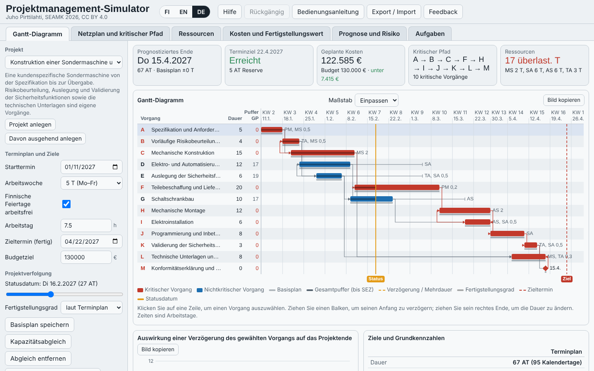
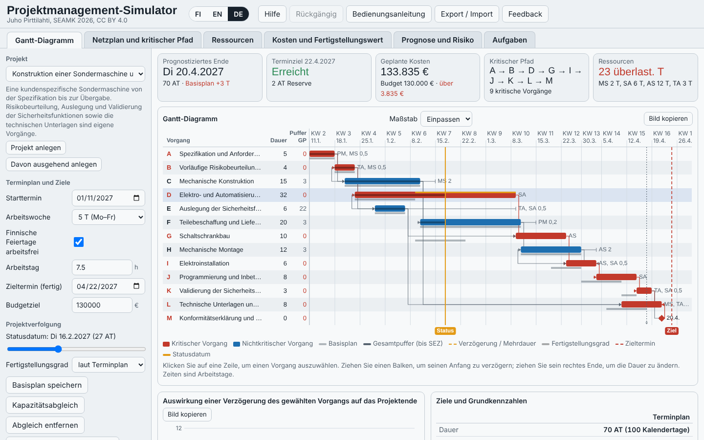
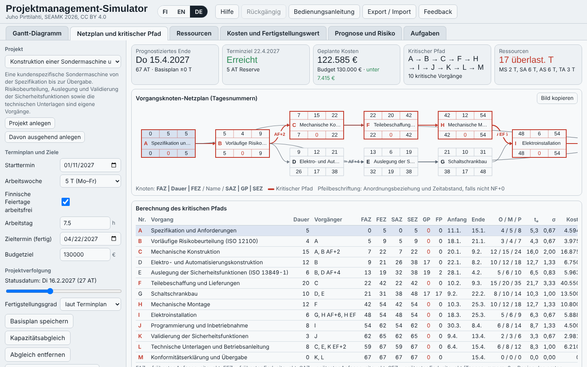
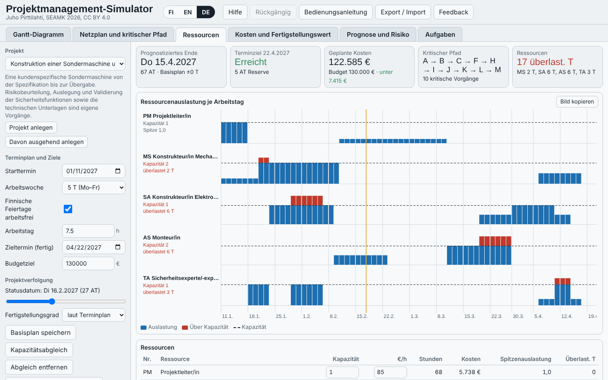
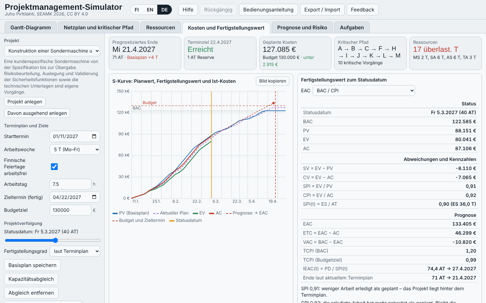
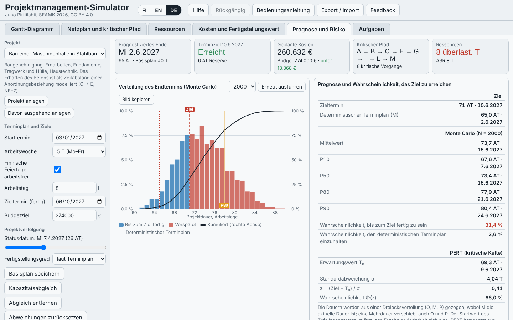
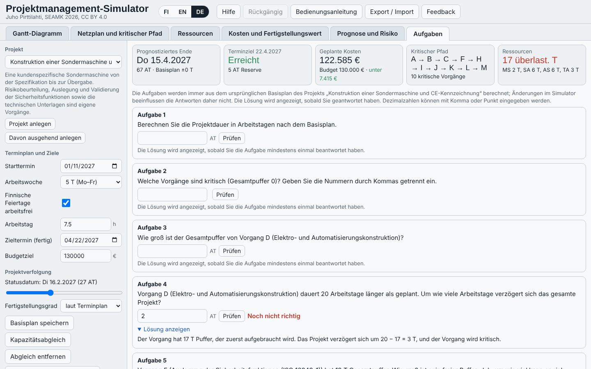
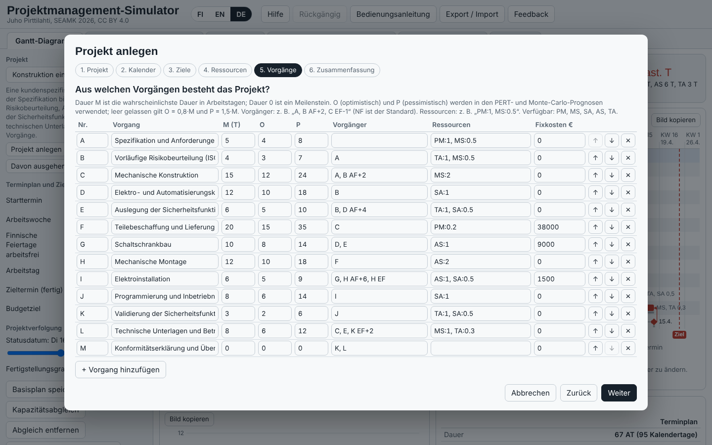

# Projektmanagement-Simulator – Bedienungsanleitung

> Diese Datei ist die versionierte Kopie der Bedienungsanleitung. Als Webseite: <https://jipirtti.github.io/Projektinhallintasimulaattori/docs/bedienungsanleitung.html>

Juho Pirttilahti, Fachhochschule Seinäjoki (SEAMK), 2026. Konzeption, Inhalt und Validierung: Juho Pirttilahti. Der Programmcode wurde KI-gestützt erstellt (Claude, Anthropic). Lizenz CC BY 4.0.

## Was der Simulator ist

Der Projektmanagement-Simulator ist ein browserbasiertes Lehrmittel zum Üben von Terminplanung, Ressourcenplanung, Kostenverfolgung und Prognose. Der Simulator zeigt sofort, wie sich die Verzögerung eines Vorgangs, fehlende Ressourcen oder eine Kostenüberschreitung auf das gesamte Projekt auswirken.

Öffnen Sie den Simulator unter <https://jipirtti.github.io/Projektinhallintasimulaattori/?lang=de>. Eine Installation ist nicht nötig. Der Simulator funktioniert auch ohne Netzverbindung, wenn die Datei `index.html` direkt im Browser geöffnet wird.

Die Berechnungsmodelle und ihre Validierung sind in [VALIDOINTI.md](https://github.com/Jipirtti/Projektinhallintasimulaattori/blob/main/VALIDOINTI.md) (auf Finnisch) beschrieben.

## Aufbau der Ansicht

| Bereich | Inhalt |
| --- | --- |
| Kopfzeile | Sprache (FI, EN, DE), Hilfe, Rückgängig, Bedienungsanleitung, Export / Import, Feedback |
| Registerkarten | Gantt-Diagramm, Netzplan und kritischer Pfad, Ressourcen, Kosten und Fertigstellungswert, Prognose und Risiko, Aufgaben |
| Linker Bereich | Projektauswahl und -anlage, Terminplan und Ziele, Projektverfolgung, Angaben und Abweichungen des gewählten Vorgangs |
| Kennzahlenzeile | Prognostiziertes Ende, Terminziel, geplante Kosten, kritischer Pfad und Ressourcenüberlastung. Die Zeile erscheint auf allen Registerkarten. |

Änderungen werden sofort in allen Ansichten aktualisiert. Der letzte Zustand bleibt im Browser für den nächsten Besuch erhalten. Rückgängig (oder Strg+Z) nimmt die letzte Änderung zurück.

## Beispielprojekte

| Projekt | Was damit geübt wird |
| --- | --- |
| Konstruktion einer Sondermaschine und CE-Kennzeichnung | Langer kritischer Pfad, Anfangsfolge und Endfolge, Überlastung der Monteure |
| Beschaffung und Inbetriebnahme einer Roboterschweißzelle | Anteil des Lieferanten als Fixkosten, verspätete Lieferung, Schulung überlappend mit der Programmierung |
| Bau einer Maschinenhalle in Stahlbauweise | Wartezeit als Zeitabstand (Aushärten des Betons, NF+7), Osterfeiertage im Kalender, Überlastung der Montagekolonne |
| FuE-Projekt: Pilotierung in Unternehmen | Lange Dauer, parallele Pfade und Puffer |
| Softwareprojekt: Instandhaltungs-App | Knapper Zieltermin und knappes Budget, die ohne Maßnahmen nicht erreicht werden |

Dauern, Stundensätze und Kosten sind erfundene Übungswerte.

## Zeit und Kalender

Dauern sind Arbeitstage (AT). Tagesnummer 0 ist der Beginn des ersten Arbeitstags. Ein Vorgang mit frühestem Anfangszeitpunkt FAZ = 5 und Dauer 3 wird an den Tagen 5, 6 und 7 bearbeitet und endet am Ende von Tag 7 (FEZ = 8). Die Dauer 0 ist ein Meilenstein.

Der Kalender überspringt Wochenenden (5-Tage-Woche). Mit der Option *Finnische Feiertage arbeitsfrei* sind außerdem Neujahr, Heilige Drei Könige, Karfreitag, Ostersonntag, Ostermontag, 1. Mai, Christi Himmelfahrt, Pfingstsonntag, Mittsommerabend und Mittsommertag, Allerheiligen, der Unabhängigkeitstag, Heiligabend sowie der erste und zweite Weihnachtstag arbeitsfrei.

## Gantt-Diagramm

| Darstellung | Bedeutung |
| --- | --- |
| Roter Balken | Kritischer Vorgang (Gesamtpuffer 0) |
| Blauer Balken | Nicht kritischer Vorgang |
| Dünner grauer Balken | Basisplan (gespeicherter Plan) |
| Dünne Linie nach dem Balken | Gesamtpuffer bis zum spätesten Endzeitpunkt (SEZ) |
| Orange gestrichelte Linie vor dem Balken | Anfangsverzögerung oder Abgleichsverzögerung |
| Oranger Streifen am oberen Rand des Balkens | Mehrdauer |
| Dunkler Streifen im Balken | Fertigstellungsgrad zum Statusdatum |
| Orange senkrechte Linie | Statusdatum |
| Rote senkrechte gestrichelte Linie | Zieltermin |

Klicken Sie auf eine Zeile, um den Vorgang im linken Bereich auszuwählen. **Ziehen Sie einen Balken** nach rechts: Der Anfang des Vorgangs verzögert sich. **Ziehen Sie das rechte Ende eines Balkens**: Die Dauer ändert sich. Den Maßstab wählen Sie oben rechts.

### Auswirkung einer Verzögerung

Das Diagramm unter dem Gantt-Diagramm zeigt, wie weit eine Verzögerung des gewählten Vorgangs das Projektende verschiebt. Der grüne Bereich ist der Gesamtpuffer des Vorgangs: Solange die Verzögerung in den Puffer passt, verschiebt sich das Ende nicht. Danach verschiebt jeder Tag Verzögerung das Ende um einen Tag.

Im Bild ist Vorgang D des CE-Beispiels (Puffer 17 T) um 20 T verlängert. Das Projekt verspätet sich um 3 T, D wird kritisch, und die Kosten steigen, weil der Konstrukteur länger arbeitet.

## Netzplan und kritischer Pfad

Im Netzplan sind die Vorgänge Knoten (Vorgangsknoten-Netzplan nach DIN 69900). Die obere Zeile eines Knotens zeigt frühesten Anfangszeitpunkt, Dauer und frühesten Endzeitpunkt (FAZ | Dauer | FEZ), die untere Zeile spätesten Anfangszeitpunkt, Gesamtpuffer und spätesten Endzeitpunkt (SAZ | GP | SEZ). Die Beschriftung eines Pfeils zeigt die Anordnungsbeziehung und den Zeitabstand, wenn sie von NF+0 abweichen.

Die Tabelle enthält alle Zwischenergebnisse der Berechnung sowie die PERT-Schätzungen.

| Anordnungsbeziehung | Bedingung |
| --- | --- |
| NF, Normalfolge (Ende–Anfang) | Der Nachfolger beginnt, wenn der Vorgänger beendet ist (Standard) |
| AF, Anfangsfolge (Anfang–Anfang) | Der Nachfolger kann beginnen, wenn der Vorgänger begonnen hat |
| EF, Endfolge (Ende–Ende) | Der Nachfolger kann enden, wenn der Vorgänger beendet ist |
| SF, Sprungfolge (Anfang–Ende) | Der Nachfolger kann enden, wenn der Vorgänger begonnen hat |

Anordnungsbeziehungen werden in der Form `A, B AF+2, C EF-1` geschrieben. Ein positiver Zeitabstand ist eine Wartezeit, ein negativer eine Überlappung.

## Ressourcen

Das Auslastungsdiagramm zeigt die Auslastung jeder Ressource je Arbeitstag. Die gestrichelte Linie ist die Kapazität, der rote Teil die Überlastung. Eine Einheit bedeutet eine Person oder ein Team in Vollzeit.

**Kapazitätsabgleich** verschiebt Vorgänge so, dass die Kapazität keiner Ressource überschritten wird. Die Vorgänge werden in der Reihenfolge ihres spätesten Anfangszeitpunkts bearbeitet, und jeder wird an der ersten Stelle eingeplant, an der die Kapazität ausreicht. Der Abgleich verbraucht zuerst Puffer; ist der Puffer aufgebraucht, verlängert sich das Projekt. Das Verfahren ist eine Heuristik und findet nicht immer den kürzestmöglichen Terminplan. **Abgleich entfernen** setzt die Vorgänge auf ihre frühesten Zeitpunkte zurück.

Kapazität und Stundensatz einer Ressource lassen sich in der Tabelle ändern.

## Kosten und Fertigstellungswert

Personalkosten eines Vorgangs = Dauer × Einheiten × Stunden je Arbeitstag × Stundensatz. Ein Vorgang kann außerdem Fixkosten haben (Beschaffungen, Unteraufträge).

Verschieben Sie das **Statusdatum** mit dem Schieberegler im linken Bereich. Standardmäßig wird der Fertigstellungsgrad aus dem aktuellen Terminplan berechnet, sodass sich eine Verzögerung direkt im Fertigstellungswert zeigt. Der Fertigstellungsgrad kann auch je Vorgang von Hand eingegeben werden.

| Kennzahl | Formel | Bedeutung |
| --- | --- | --- |
| PV | Planwert des Basisplans bis zum Statusdatum | Wie viel Arbeit erledigt sein sollte (€) |
| EV | BAC × Fertigstellungsgrad | Budgetierter Wert der erledigten Arbeit, Fertigstellungswert (€) |
| AC | Ist-Kosten | Was die erledigte Arbeit gekostet hat (€) |
| SV, CV | EV − PV, EV − AC | Negativ = Terminverzug bzw. Kostenüberschreitung |
| SPI, CPI | EV / PV, EV / AC | Unter 1 = im Verzug bzw. teurer als geplant (Termin- bzw. Kostenleistungsindex) |
| EAC | BAC / CPI (oder zwei weitere Verfahren aus dem Menü) | Prognostizierte Gesamtkosten |
| TCPI | (BAC − EV) / (BAC − AC) | Kosteneffizienz, die die verbleibende Arbeit erfordert |
| SPI(t), IEAC(t) | ES / AT, geplante Dauer / SPI(t) | Earned Schedule: zeitbasierter Index und Dauerprognose |

Der gewöhnliche SPI nähert sich am Projektende trotz Verzug dem Wert 1, weil PV nicht mehr wächst. Der Earned-Schedule-Index SPI(t) verhält sich nicht so.

**Abweichungen (Was-wäre-wenn):** Die *Mehrdauer* des gewählten Vorgangs verlängert den Vorgang, die *Anfangsverzögerung* verschiebt seinen Anfang, und *Ist-Kosten im Verhältnis zum Plan* gibt an, wie viel Prozent der geplanten Kosten die erledigte Arbeit tatsächlich gekostet hat. Klicken Sie auf **Basisplan speichern**, wenn der Plan genehmigt ist; Abweichungen werden mit ihm verglichen.

## Prognose und Risiken

**PERT** berechnet für die Vorgänge der kritischen Kette den Erwartungswert tₑ = (O + 4M + P)/6 und die Standardabweichung σ = (P − O)/6 und daraus mit der Normalverteilung die Wahrscheinlichkeit, bis zum Zieltermin fertig zu sein.

**Monte Carlo** zieht die Dauer jedes Vorgangs aus einer Dreiecksverteilung (O, M, P) und berechnet den Terminplan 500- bis 5000-mal. Ergebnisse sind die Verteilung des Endtermins, die Werte P50, P80 und P90, die Wahrscheinlichkeit, das Ziel einzuhalten, und der Kritikalitätsindex (Anteil der Durchläufe, in denen der Vorgang kritisch war). Der Startwert des Zufallsgenerators ist fest, daher wiederholt sich das Ergebnis.

Monte Carlo berücksichtigt parallele Pfade: Wenn mehrere Pfade zusammenlaufen, verschiebt eine Verzögerung auf jedem von ihnen das Ende. Deshalb liefert PERT meist ein optimistischeres Ergebnis.

## Aufgaben

Jedes Projekt hat 10–13 Aufgaben: Gesamtdauer, kritische Vorgänge, Gesamt- und freier Puffer, Auswirkung einer Verzögerung, BAC, PERT-Wahrscheinlichkeit, Ressourcenüberlastung und Kapazitätsabgleich sowie SPI, CPI, EAC und Verzug in einer Situation der Projektverfolgung.

- Die Antworten werden immer aus dem ursprünglichen Basisplan des Projekts berechnet. Änderungen im Simulator wirken sich nicht darauf aus.
- **Die Lösung wird erst angezeigt, nachdem die Aufgabe einmal beantwortet wurde.** Eine leere Antwort öffnet die Lösung nicht.
- Dezimalzahlen können mit Komma oder Punkt geschrieben werden. Geldbeträge werden mit einer Abweichung von 0,5–1 % akzeptiert, Indizes mit ±0,01 und die PERT-Wahrscheinlichkeit mit ±3 Prozentpunkten.
- *Situation in den Simulator laden* übernimmt die Abweichungen der Projektverfolgungssituation in den Simulator, sodass sich die Berechnungen auf den anderen Registerkarten prüfen lassen.

## Eigenes Projekt

Wählen Sie im Projektmenü **Projekt anlegen …** oder klicken Sie auf *Projekt anlegen*. Die Fragen sind in sechs Schritte gegliedert:

| Schritt | Frage |
| --- | --- |
| 1. Projekt | Um welches Projekt handelt es sich? Name, Beschreibung und Vorlage (leer, Beispiel, eigenes Projekt oder aktueller Plan) |
| 2. Kalender | Wann beginnt das Projekt, und mit welchem Kalender wird gearbeitet? |
| 3. Ziele | Terminziel als Datum oder Planende ± Arbeitstage; Budgetziel in Euro oder geplante Kosten ± % |
| 4. Ressourcen | Wer erledigt die Arbeit? Kennung, Name, Kapazität und Stundensatz |
| 5. Vorgänge | Aus welchen Vorgängen besteht das Projekt? Kennung, Name, Dauer M, O, P, Vorgänger, Ressourcen (z. B. `PM:1, MS:0.5`) und Fixkosten |
| 6. Zusammenfassung | Dauer, Ende, Kosten, Ziele, kritische Kette und Überlastung |

Die Zusammenfassung listet die Fehler auf, die vor dem Anlegen behoben werden müssen: unbekannter Vorgänger oder unbekannte Ressource, dieselbe Kennung doppelt oder eine Schleife in den Anordnungsbeziehungen. Ein leeres O ist 0,8·M, ein leeres P 1,5·M.

Für ein eigenes Projekt werden die Aufgaben automatisch erstellt, auch eine Situation der Projektverfolgung: Das Statusdatum liegt in der Projektmitte, ein kritischer Vorgang überschreitet seine Dauer um etwa 30 %, und die Kosten eines Vorgangs werden um 15 % überschritten. Ein eigenes Projekt lässt sich mit denselben Fragen bearbeiten (*Mit Fragen bearbeiten*) oder löschen (das Löschen wird mit einem zweiten Klick bestätigt).

Eigene Projekte werden nur in dem Browser gespeichert, in dem sie angelegt wurden. **Export / Import** überträgt ein Projekt auf einen anderen Rechner oder an Studierende: Kopieren Sie den Text und fügen Sie ihn im anderen Browser in das Fenster *Export / Import* ein. Ein importiertes eigenes Projekt wird dem Projektmenü hinzugefügt.

## Für Lehrkräfte: Aufgabenideen

1. CE-Beispiel: Finden Sie heraus, warum die Elektro- und Automatisierungskonstruktion (D) nicht kritisch ist. Um wie viel kann sie sich verlängern? Prüfen Sie die Antwort, indem Sie den Balken ziehen.
2. Maschinenhalle: Entfernen Sie den Zeitabstand für das Aushärten des Betons (`C NF+7` → `C`). Um wie viel verkürzt sich das Projekt, und warum um weniger als 7 T?
3. Softwareprojekt: Zieltermin und Budget werden nicht erreicht. Finden Sie eine Maßnahme (eine Ressource, eine Überlappung, das Aufteilen eines Vorgangs) und begründen Sie ihre Auswirkung auf die Kosten.
4. Roboterzelle: Der Lieferant meldet eine Verzögerung von 6 T. Was geschieht mit dem SPI vor und nach dem Ende laut Basisplan? Vergleichen Sie mit SPI(t).
5. Legen Sie mit den Fragen ein eigenes Projekt an und vergleichen Sie die Wahrscheinlichkeiten nach PERT und Monte Carlo. Warum unterscheiden sie sich?

## Diagramm als Bild kopieren

Jedes Diagramm hat in der Ecke eine Schaltfläche **Bild kopieren**. Sie kopiert das Diagramm als PNG-Bild in die Zwischenablage, das sich direkt in einen Bericht, eine Folie oder eine Nachricht einfügen lässt (Strg+V).

- Das Bild wird immer mit hellem Hintergrund gezeichnet, auch wenn der Simulator ein dunkles Design verwendet, und in doppelter Auflösung.
- Das Bild enthält Diagrammtitel, Diagramm, Legende und Quellenangabe (Name des Simulators, Juho Pirttilahti, SEAMK, CC BY 4.0, Webadresse und Datum).
- Die Schaltfläche befindet sich in der Titelzeile jedes Diagramms: Gantt-Diagramm, Auswirkung einer Verzögerung, Netzplan, Ressourcenauslastung, S-Kurve und Monte-Carlo-Verteilung.
- Gantt-Diagramm und Netzplan werden vollständig kopiert, auch der Teil außerhalb des sichtbaren Bereichs.
- Erlaubt der Browser das Kopieren in die Zwischenablage nicht, öffnet sich das Bild in einem Fenster. Dort lässt es sich mit der rechten Maustaste (am Telefon durch langes Drücken) kopieren oder als PNG-Datei speichern.

## Feedback

Die Schaltfläche **Feedback** in der Kopfzeile öffnet ein Formular, das eine vorausgefüllte Meldung für das GitHub-Repository des Simulators erstellt. Wählen Sie die Art: *Berechnungsergebnis entspricht nicht der Erwartung*, *Fehler* oder *Verbesserungsvorschlag*. Das aktuelle Projekt wird im JSON-Format angehängt, damit sich die Situation genau reproduzieren lässt. Ohne GitHub-Konto verwenden Sie die Schaltflächen *Bericht kopieren* oder *Per E-Mail senden*.

## Grenzen

Das Modell ist für die Lehre vereinfacht: Ressourcen haben keine eigenen Kalender, Vorgänge können nicht unterbrochen werden, die Auslastung ist über die Vorgangsdauer gleichmäßig, und Zeiten sind ganze Arbeitstage. Der Simulator eignet sich nicht für die verbindliche Termin- oder Kostenplanung realer Projekte.
