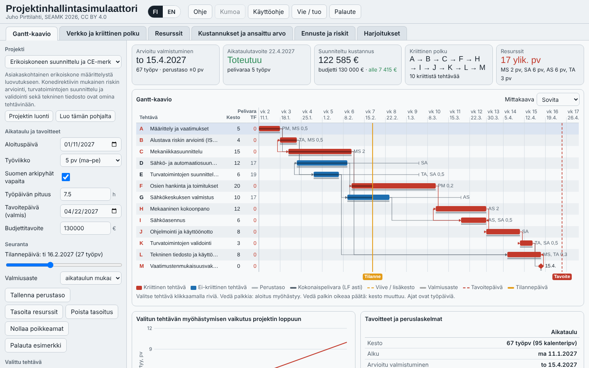
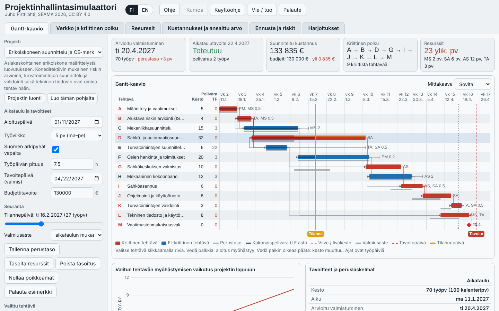
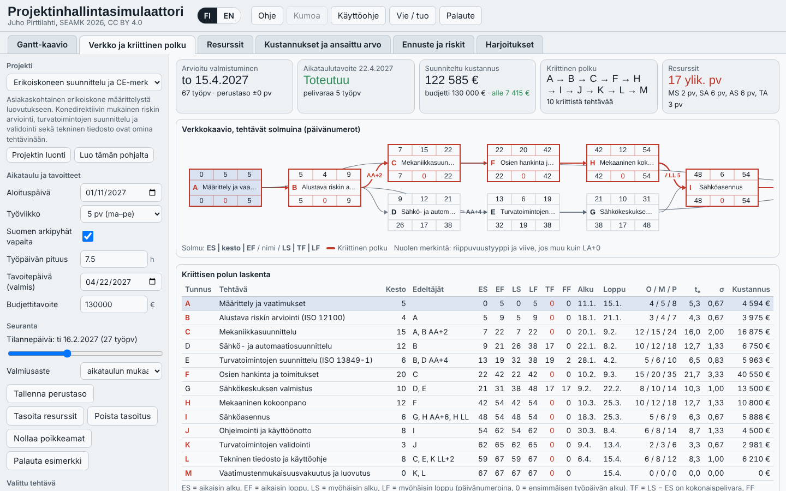
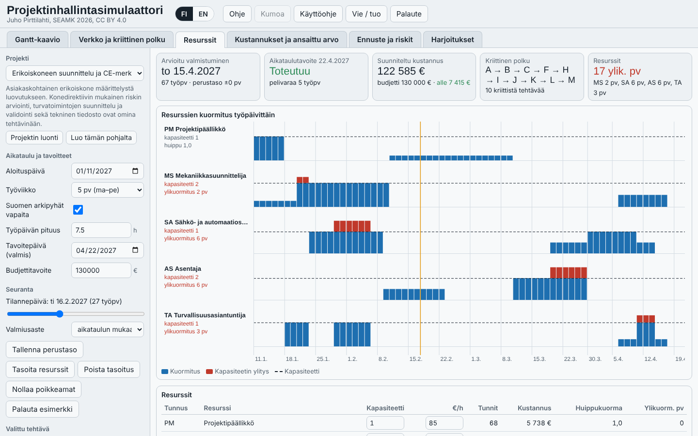
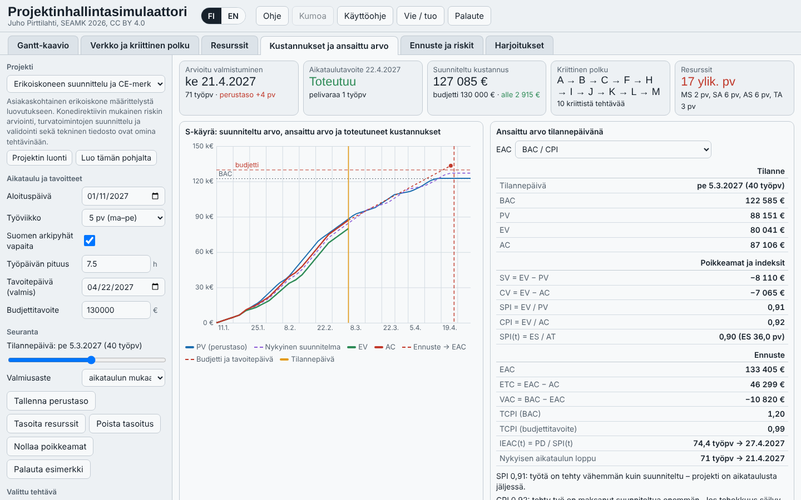
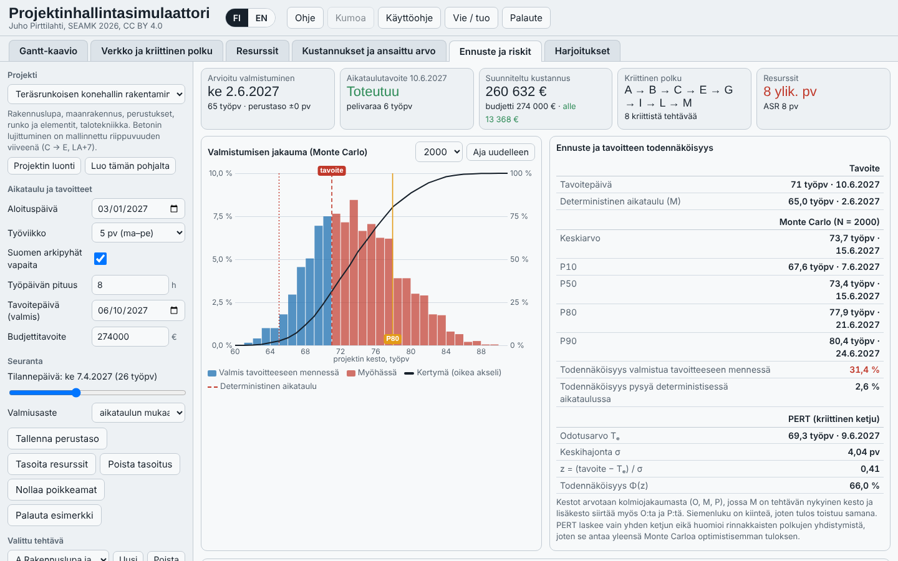
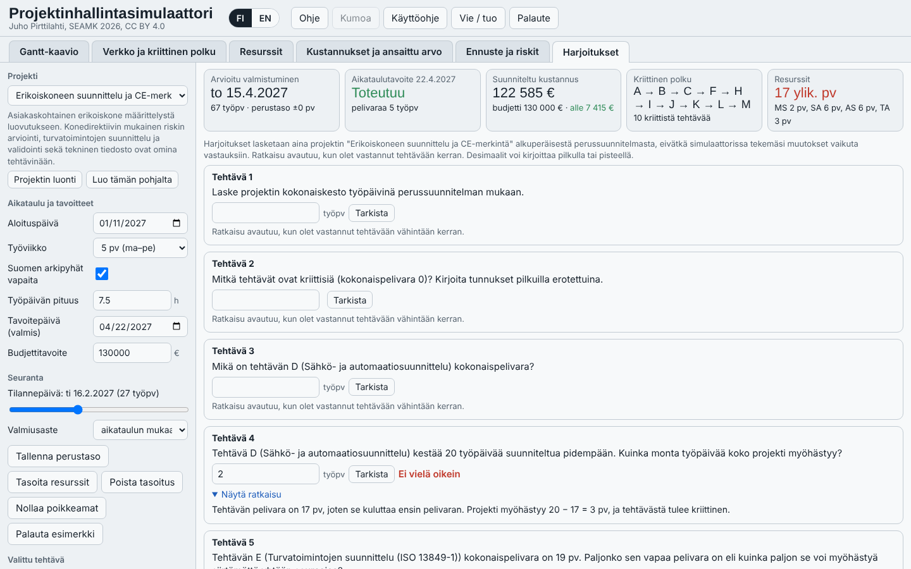
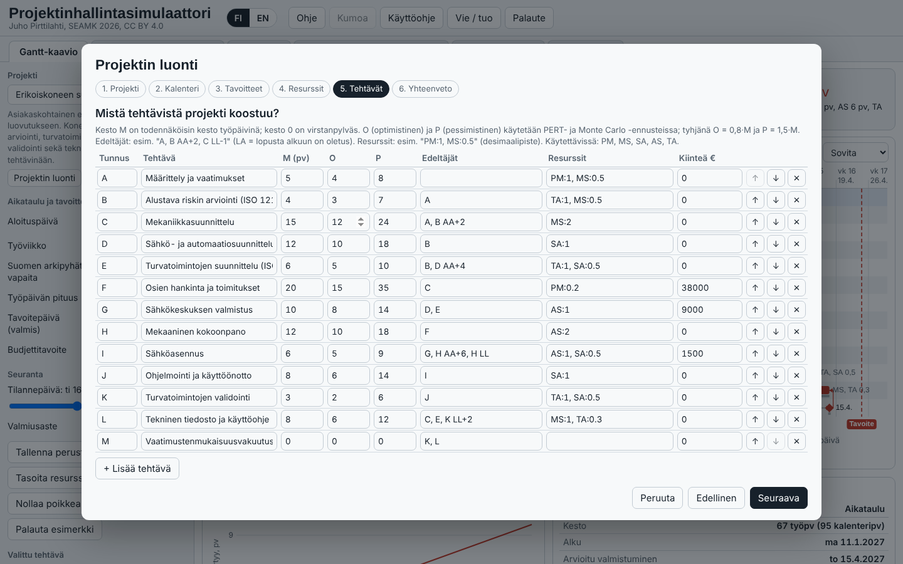

# Projektinhallintasimulaattori – käyttöohje

> Tämä tiedosto on käyttöohjeen versioitu kopio. Verkkosivuna: <https://jipirtti.github.io/Projektinhallintasimulaattori/docs/kayttoohje.html>

Juho Pirttilahti, Seinäjoen ammattikorkeakoulu (SEAMK), 2026. Suunnittelu, sisältö ja validointi: Juho Pirttilahti. Ohjelmakoodi toteutettu tekoälyavusteisesti (Claude, Anthropic). Lisenssi CC BY 4.0.

## Mikä simulaattori on

Projektinhallintasimulaattori on selaimessa toimiva opetusväline, jolla harjoitellaan projektin aikataulutusta, resurssointia, kustannusseurantaa ja ennustamista. Simulaattorilla näkee heti, miten yhden tehtävän myöhästyminen, resurssin puute tai kustannusylitys vaikuttaa koko projektiin.

Avaa simulaattori osoitteessa <https://jipirtti.github.io/Projektinhallintasimulaattori/>. Asennusta ei tarvita. Simulaattori toimii myös avaamalla tiedoston `index.html` suoraan selaimessa ilman verkkoyhteyttä.

Laskentamallit ja niiden validointi on kuvattu tiedostossa [VALIDOINTI.md](https://github.com/Jipirtti/Projektinhallintasimulaattori/blob/main/VALIDOINTI.md).

## Näkymän osat

| Alue | Sisältö |
| --- | --- |
| Yläpalkki | Kieli (FI, EN), Ohje, Kumoa, Käyttöohje, Vie / tuo, Palaute |
| Välilehdet | Gantt-kaavio, Verkko ja kriittinen polku, Resurssit, Kustannukset ja ansaittu arvo, Ennuste ja riskit, Harjoitukset |
| Vasen paneeli | Projektin valinta ja luonti, aikataulu ja tavoitteet, seuranta, valitun tehtävän tiedot ja poikkeamat |
| Tunnuslukurivi | Arvioitu valmistuminen, aikataulutavoite, suunniteltu kustannus, kriittinen polku ja resurssien ylikuormitus. Rivi näkyy kaikilla välilehdillä. |

Muutokset päivittyvät heti kaikkiin näkymiin. Viimeisin tila säilyy selaimessa seuraavaan kertaan. Kumoa (tai Ctrl+Z) peruu edellisen muutoksen.

## Esimerkkiprojektit

| Projekti | Mitä sillä harjoitellaan |
| --- | --- |
| Erikoiskoneen suunnittelu ja CE-merkintä | Pitkä kriittinen polku, alku–alku- ja loppu–loppu-riippuvuudet, asentajien ylikuormitus |
| Robottihitsaussolun hankinta ja käyttöönotto | Toimittajan osuus kiinteänä kustannuksena, toimitusajan myöhästyminen, koulutus limittäin ohjelmoinnin kanssa |
| Teräsrunkoisen konehallin rakentaminen | Odotusaika viiveenä (betonin lujittuminen, LA+7), pääsiäisen arkipyhät kalenterissa, asennusryhmän ylikuormitus |
| TKI-hanke: pilotointi yrityksissä | Pitkä kesto, rinnakkaiset polut ja pelivarat |
| Ohjelmistoprojekti: huoltosovellus | Tiukka tavoitepäivä ja budjetti, jotka eivät toteudu ilman toimenpiteitä |

Kestot, tuntihinnat ja kustannukset ovat keksittyjä harjoitusarvoja.

## Aika ja kalenteri

Kestot ovat työpäiviä. Päivänumero 0 on ensimmäisen työpäivän alku. Tehtävä, jonka aikaisin alku on ES = 5 ja kesto 3, tehdään päivinä 5, 6 ja 7 ja valmistuu päivän 7 lopussa (EF = 8). Kesto 0 on virstanpylväs.

Kalenteri ohittaa viikonloput (5 päivän viikko). Valinnalla *Suomen arkipyhät vapaita* myös uudenvuodenpäivä, loppiainen, pitkäperjantai, pääsiäispäivä, 2. pääsiäispäivä, vappu, helatorstai, helluntaipäivä, juhannusaatto ja -päivä, pyhäinpäivä, itsenäisyyspäivä sekä joulu- ja tapaninpäivä ja jouluaatto ovat vapaita.

## Gantt-kaavio

| Merkintä | Merkitys |
| --- | --- |
| Punainen palkki | Kriittinen tehtävä (kokonaispelivara 0) |
| Sininen palkki | Ei-kriittinen tehtävä |
| Ohut harmaa palkki | Perustaso (tallennettu suunnitelma) |
| Ohut viiva palkin jälkeen | Kokonaispelivara myöhäisimpään loppuun (LF) asti |
| Oranssi katkoviiva palkin edessä | Aloitusviive tai tasoitusviive |
| Oranssi raita palkin yläreunassa | Lisäkesto |
| Tumma raita palkin sisällä | Valmiusaste tilannepäivänä |
| Oranssi pystyviiva | Tilannepäivä |
| Punainen pystykatkoviiva | Tavoitepäivä |

Klikkaa riviä, niin tehtävä valitaan vasempaan paneeliin. **Vedä palkkia** oikealle: tehtävän aloitus myöhästyy. **Vedä palkin oikeaa päätä**: kesto muuttuu. Mittakaavan voi valita oikeasta yläkulmasta.

### Myöhästymisen vaikutus

Gantt-kaavion alla oleva kuvaaja näyttää, kuinka paljon valitun tehtävän myöhästyminen siirtää projektin loppua. Vihreä alue on tehtävän kokonaispelivara: niin kauan kuin myöhästyminen mahtuu pelivaraan, loppu ei siirry. Sen jälkeen jokainen myöhästymispäivä siirtää loppua yhden päivän.

Kuvassa CE-esimerkin tehtävä D (pelivara 17 pv) on venynyt 20 pv. Projekti myöhästyy 3 pv, D muuttuu kriittiseksi ja kustannukset kasvavat, koska suunnittelija tekee työtä pidempään.

## Verkko ja kriittinen polku

Verkkokaaviossa tehtävät ovat solmuina. Solmun ylärivillä on aikaisin alku, kesto ja aikaisin loppu (ES | kesto | EF), alarivillä myöhäisin alku, kokonaispelivara ja myöhäisin loppu (LS | TF | LF). Nuolen merkintä kertoo riippuvuustyypin ja viiveen, jos se on muu kuin LA+0.

Taulukossa ovat kaikki laskennan välitulokset sekä PERT-arviot.

| Riippuvuus | Ehto |
| --- | --- |
| LA (FS), lopusta alkuun | Seuraaja alkaa, kun edeltäjä on valmis (oletus) |
| AA (SS), alusta alkuun | Seuraaja voi alkaa, kun edeltäjä on alkanut |
| LL (FF), lopusta loppuun | Seuraaja voi valmistua, kun edeltäjä on valmis |
| AL (SF), alusta loppuun | Seuraaja voi valmistua, kun edeltäjä on alkanut |

Riippuvuudet kirjoitetaan muodossa `A, B AA+2, C LL-1`. Positiivinen viive on odotusaika, negatiivinen limitys.

## Resurssit

Kuormituskuvaaja näyttää jokaisen resurssin kuorman työpäivittäin. Katkoviiva on kapasiteetti ja punainen osa kapasiteetin ylitys. Yksikkö 1 tarkoittaa yhtä henkilöä tai ryhmää kokoaikaisesti.

**Tasoita resurssit** siirtää tehtäviä niin, ettei yhdenkään resurssin kapasiteetti ylity. Tehtävät käsitellään myöhäisimmän alkamisajan mukaisessa järjestyksessä, ja kukin sijoitetaan ensimmäiseen kohtaan, jossa kapasiteetti riittää. Tasoitus käyttää ensin pelivaraa; kun pelivara loppuu, projekti pitenee. Menetelmä on heuristiikka eikä löydä aina lyhintä mahdollista aikataulua. **Poista tasoitus** palauttaa tehtävät aikaisimpiin aikoihinsa.

Taulukossa voi muuttaa resurssin kapasiteettia ja tuntihintaa.

## Kustannukset ja ansaittu arvo

Tehtävän työkustannus = kesto × yksiköt × työpäivän tunnit × tuntihinta. Lisäksi tehtävällä voi olla kiinteä kustannus (hankinnat, alihankinta).

Siirrä **tilannepäivää** vasemman paneelin liukusäätimellä. Valmiusaste lasketaan oletuksena nykyisen aikataulun mukaan, jolloin myöhästyminen näkyy suoraan ansaitussa arvossa. Valmiusasteen voi myös syöttää käsin tehtäväkohtaisesti.

| Tunnusluku | Kaava | Tulkinta |
| --- | --- | --- |
| PV | perustason suunniteltu arvo tilannepäivään mennessä | Kuinka paljon työtä piti olla tehtynä (€) |
| EV | BAC × valmiusaste | Tehdyn työn budjetoitu arvo (€) |
| AC | toteutuneet kustannukset | Mitä tehty työ maksoi (€) |
| SV, CV | EV − PV, EV − AC | Negatiivinen = jäljessä tai ylitys |
| SPI, CPI | EV / PV, EV / AC | Alle 1 = jäljessä tai kalliimpi kuin suunniteltu |
| EAC | BAC / CPI (tai kaksi muuta tapaa valikosta) | Loppukustannusennuste |
| TCPI | (BAC − EV) / (BAC − AC) | Kustannustehokkuus, jota jäljellä oleva työ vaatii |
| SPI(t), IEAC(t) | ES / AT, suunniteltu kesto / SPI(t) | Ansaittu aikataulu: aikaperusteinen indeksi ja kestoennuste |

Tavallinen SPI lähestyy arvoa 1 projektin lopussa myöhästymisestä huolimatta, koska PV ei enää kasva. Ansaitun aikataulun SPI(t) ei käyttäydy näin.

**Poikkeamat (mitä jos):** valitun tehtävän *lisäkesto* pidentää tehtävää, *aloitusviive* siirtää sen alkua ja *toteutuneet kustannukset suunnitellusta* kertoo, montako prosenttia suunnitellusta tehty työ on oikeasti maksanut. **Tallenna perustaso**, kun suunnitelma on hyväksytty; poikkeamia verrataan siihen.

## Ennuste ja riskit

**PERT** laskee kriittisen ketjun tehtävistä odotusarvon tₑ = (O + 4M + P)/6 ja hajonnan σ = (P − O)/6 ja niistä normaalijakauman avulla todennäköisyyden valmistua tavoitepäivään mennessä.

**Monte Carlo** arpoo jokaisen tehtävän keston kolmiojakaumasta (O, M, P) ja laskee aikataulun 500–5000 kertaa. Tuloksena ovat valmistumisen jakauma, P50-, P80- ja P90-arvot, todennäköisyys pysyä tavoitteessa ja kriittisyysindeksi (osuus kierroksista, joilla tehtävä oli kriittinen). Siemenluku on kiinteä, joten tulos toistuu samana.

Monte Carlo huomioi rinnakkaiset polut: kun usea polku yhdistyy, myöhästyminen millä tahansa niistä siirtää loppua. Siksi PERT antaa yleensä optimistisemman tuloksen.

## Harjoitukset

Jokaisessa projektissa on 10–13 harjoitusta: kokonaiskesto, kriittiset tehtävät, kokonais- ja vapaa pelivara, myöhästymisen vaikutus, BAC, PERT-todennäköisyys, resurssien ylikuormitus ja tasoitus sekä seurantatilanteen SPI, CPI, EAC ja myöhästyminen.

- Vastaukset lasketaan aina projektin alkuperäisestä perussuunnitelmasta. Simulaattorissa tehdyt muutokset eivät vaikuta niihin.
- **Ratkaisu avautuu vasta, kun tehtävään on vastattu kerran.** Tyhjä vastaus ei avaa ratkaisua.
- Desimaalit voi kirjoittaa pilkulla tai pisteellä. Rahamäärissä hyväksytään 0,5–1 %:n poikkeama, indekseissä ±0,01 ja PERT-todennäköisyydessä ±3 prosenttiyksikköä.
- *Lataa tilanne simulaattoriin* tuo seurantatilanteen poikkeamat simulaattoriin, jolloin laskut voi tarkistaa muilta välilehdiltä.

## Oma projekti

Valitse projektivalikosta **Projektin luonti…** tai paina *Projektin luonti*. Kysely etenee kuudessa vaiheessa:

| Vaihe | Kysymys |
| --- | --- |
| 1. Projekti | Mikä projekti on kyseessä? Nimi, kuvaus ja pohja (tyhjä, esimerkki, oma projekti tai nykyinen suunnitelma) |
| 2. Kalenteri | Milloin projekti alkaa ja millä kalenterilla työskennellään? |
| 3. Tavoitteet | Aikataulutavoite päivämääränä tai suunnitelman loppu ± työpäivää; budjettitavoite euroina tai suunniteltu kustannus ± % |
| 4. Resurssit | Ketkä tekevät työn? Tunnus, nimi, kapasiteetti ja tuntihinta |
| 5. Tehtävät | Mistä tehtävistä projekti koostuu? Tunnus, nimi, kesto M, O, P, edeltäjät, resurssit (esim. `PM:1, MS:0.5`) ja kiinteä kustannus |
| 6. Yhteenveto | Kesto, valmistuminen, kustannus, tavoitteet, kriittinen ketju ja ylikuormitus |

Yhteenveto luettelee virheet, jotka on korjattava ennen luontia: tuntematon edeltäjä tai resurssi, sama tunnus kahdesti tai silmukka riippuvuuksissa. Tyhjä O on 0,8·M ja tyhjä P 1,5·M.

Omalle projektille muodostetaan harjoitukset automaattisesti, myös seurantatilanne: tilannepäivä on projektin puolivälissä, yksi kriittinen tehtävä venyy noin 30 % ja yhden tehtävän kustannukset ylittyvät 15 %. Omaa projektia voi muokata samalla kyselyllä (*Muokkaa kysymyksillä*) tai poistaa (poisto vahvistetaan toisella painalluksella).

Omat projektit tallentuvat vain siihen selaimeen, jossa ne luotiin. **Vie / tuo** siirtää projektin toiselle koneelle tai opiskelijoille: kopioi teksti ja liitä se toisessa selaimessa *Vie / tuo* -ikkunaan. Tuotu oma projekti lisätään projektivalikkoon.

## Opettajalle: tehtäväideoita

1. CE-esimerkki: selvitä, miksi sähkö- ja automaatiosuunnittelu (D) ei ole kriittinen. Kuinka paljon se voi venyä? Tarkista vastaus vetämällä palkkia.
2. Konehalli: poista betonin lujittumisviive (`C LA+7` → `C`). Kuinka paljon projekti lyhenee, ja miksi vähemmän kuin 7 pv?
3. Ohjelmistoprojekti: tavoitepäivä ja budjetti eivät toteudu. Etsi keino (resurssi, limitys, tehtävän pilkkominen) ja perustele sen vaikutus kustannuksiin.
4. Robottisolu: toimittaja ilmoittaa 6 pv:n myöhästymisestä. Mitä tapahtuu SPI:lle ennen ja jälkeen perustason lopun? Vertaa SPI(t):hen.
5. Laadi oma projekti kyselyllä ja vertaa PERT- ja Monte Carlo -todennäköisyyksiä. Miksi ne eroavat?

## Kaavion kopiointi kuvana

Jokaisen kaavion kulmassa on painike **Kopioi kuva**. Se kopioi kaavion leikepöydälle PNG-kuvana, jonka voi liittää suoraan raporttiin, diaan tai viestiin (Ctrl+V).

- Kuva piirretään aina vaalealla taustalla, vaikka simulaattori olisi tummassa teemassa, ja kaksinkertaisella tarkkuudella.
- Kuvassa ovat kaavion otsikko, kaavio, selite ja lähdemerkintä (simulaattorin nimi, Juho Pirttilahti, SEAMK, CC BY 4.0, verkko-osoite ja päivämäärä).
- Painike on jokaisen kaavion otsikkorivillä: Gantt-kaavio, myöhästymisen vaikutus, verkkokaavio, resurssien kuormitus, S-käyrä ja Monte Carlo -jakauma.
- Gantt- ja verkkokaavio kopioituvat kokonaan, myös vierityksen ulkopuolelle jäävä osa.
- Jos selain ei salli kopiointia leikepöydälle, kuva avautuu ikkunaan. Sieltä sen voi kopioida hiiren oikealla painikkeella (puhelimessa painamalla pitkään) tai tallentaa PNG-tiedostona.

## Palaute

Yläpalkin **Palaute**-painike avaa lomakkeen, joka tekee valmiiksi täytetyn ilmoituksen simulaattorin GitHub-repoon. Valitse tyyppi: *laskentatulos ei vastaa odotusta*, *virhe* tai *kehitysehdotus*. Nykyinen projekti liitetään JSON-muodossa, jotta tilanne voidaan toistaa täsmälleen. Ilman GitHub-tiliä voi käyttää painikkeita *Kopioi raportti* tai *Lähetä sähköpostilla*.

## Rajoitukset

Malli on yksinkertaistettu opetuskäyttöön: resursseilla ei ole omia kalentereita, tehtäviä ei voi keskeyttää, kuormitus on tehtävän ajan tasainen ja ajat ovat kokonaisia työpäiviä. Simulaattori ei sovellu todellisten projektien sitovaan aikataulu- tai kustannuslaskentaan.
