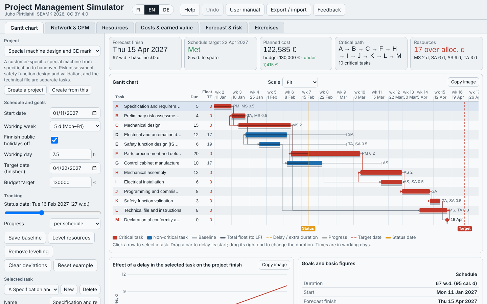
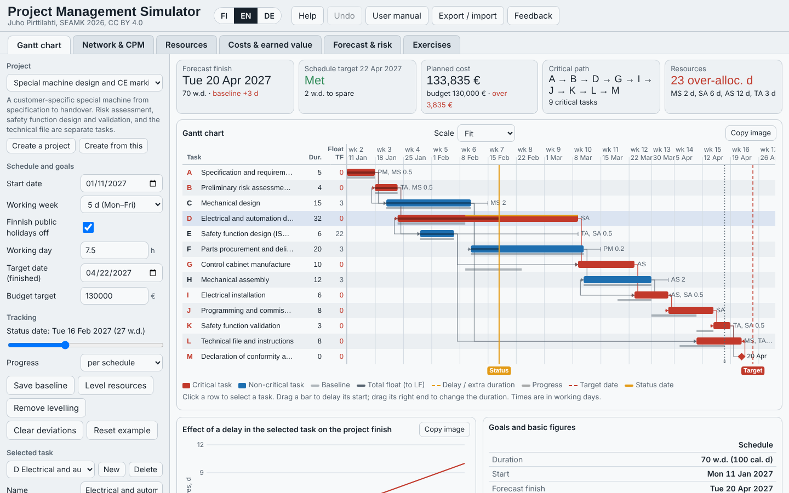
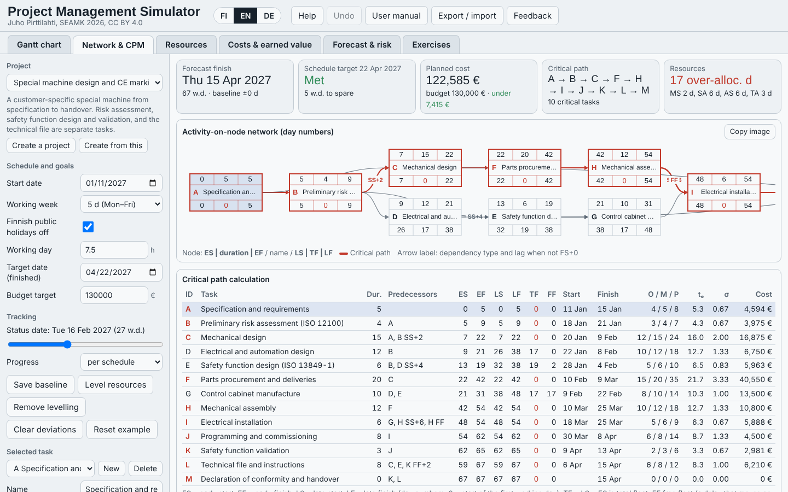
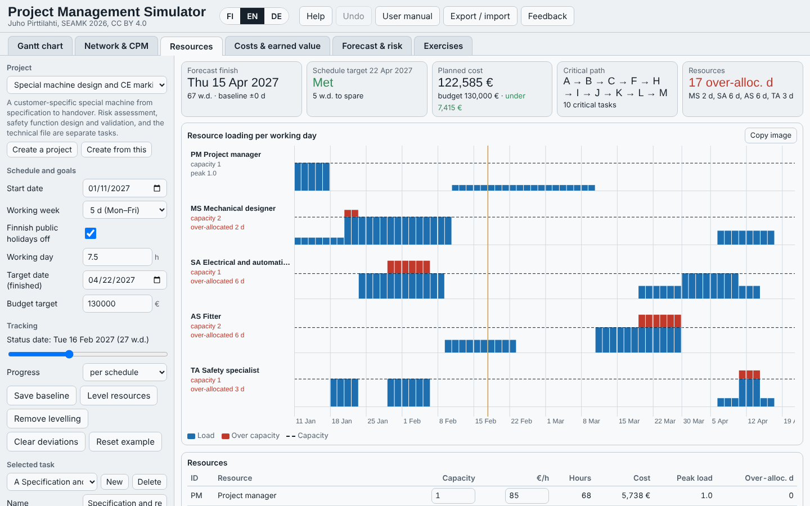
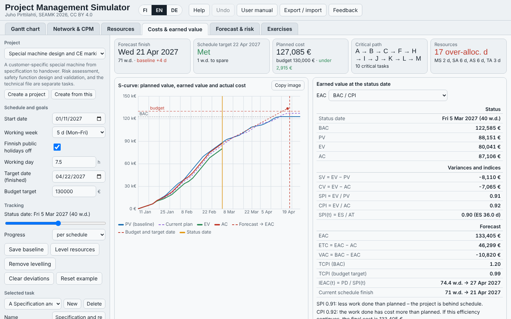
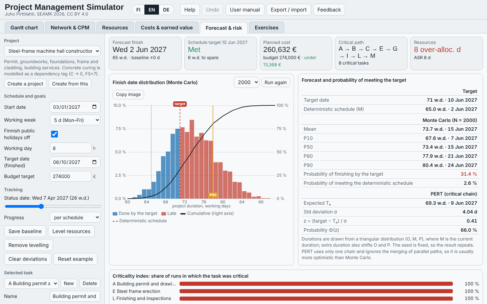
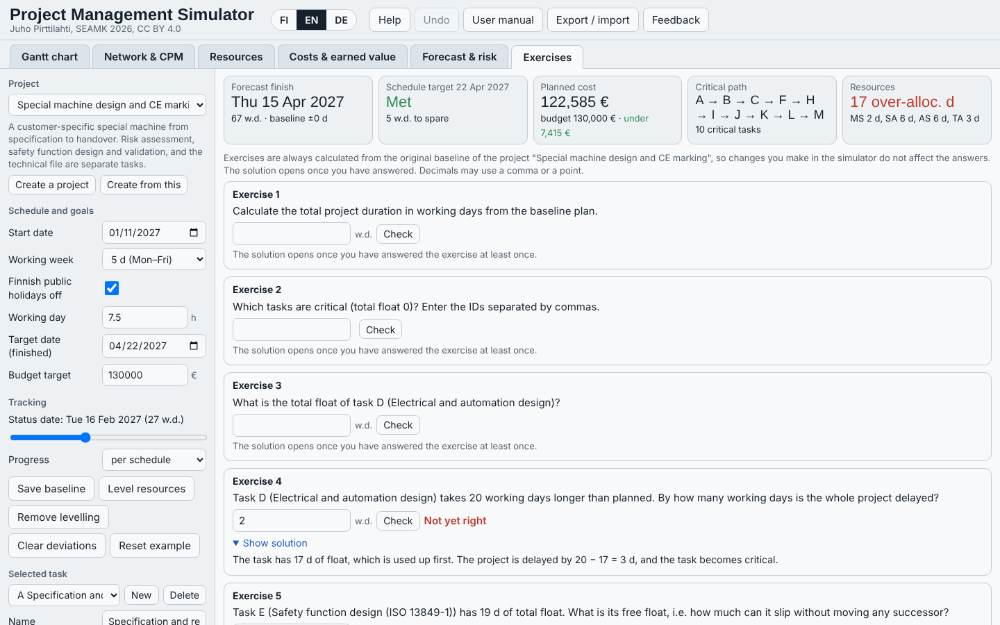
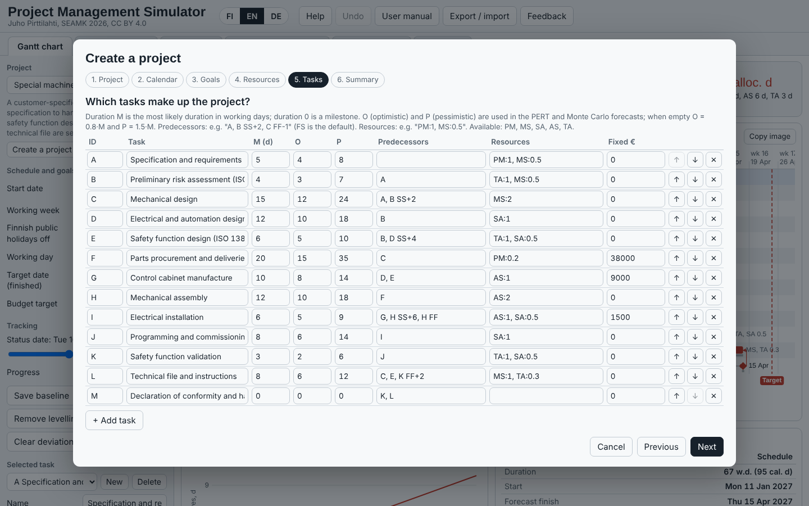

# Project Management Simulator – user manual

> This file is the versioned copy of the user manual. As a web page: <https://jipirtti.github.io/Projektinhallintasimulaattori/docs/user-manual.html>

Juho Pirttilahti, Seinäjoki University of Applied Sciences (SEAMK), 2026. Design, content and validation: Juho Pirttilahti. Code implemented with AI assistance (Claude, Anthropic). Licence CC BY 4.0.

## What the simulator is

The Project Management Simulator is a browser-based teaching tool for practising project scheduling, resourcing, cost tracking and forecasting. The simulator shows immediately how a delay in one task, a lack of resources or a cost overrun affects the whole project.

Open the simulator at <https://jipirtti.github.io/Projektinhallintasimulaattori/?lang=en>. No installation is needed. The simulator also works offline by opening the file `index.html` directly in a browser.

The calculation models and their validation are described in [VALIDOINTI.md](https://github.com/Jipirtti/Projektinhallintasimulaattori/blob/main/VALIDOINTI.md) (in Finnish).

## Parts of the view

| Area | Content |
| --- | --- |
| Header | Language (FI, EN, DE), Help, Undo, User manual, Export / import, Feedback |
| Tabs | Gantt chart, Network & CPM, Resources, Costs & earned value, Forecast & risk, Exercises |
| Left panel | Project selection and creation, schedule and goals, tracking, details and deviations of the selected task |
| Key figure row | Forecast finish, schedule target, planned cost, critical path and resource over-allocation. The row is shown on all tabs. |

Changes update all views immediately. The latest state is kept in the browser for the next visit. Undo (or Ctrl+Z) reverses the previous change.

## Example projects

| Project | What it practises |
| --- | --- |
| Special machine design and CE marking | A long critical path, start-to-start and finish-to-finish dependencies, over-allocated fitters |
| Robotic welding cell procurement and commissioning | The supplier's share as a fixed cost, a delayed delivery, training overlapping with programming |
| Steel-frame machine hall construction | A waiting time as a lag (concrete curing, FS+7), Easter public holidays in the calendar, an over-allocated erection crew |
| RDI project: company pilots | Long duration, parallel paths and floats |
| Software project: maintenance app | A tight target date and budget that are not met without action |

Durations, hourly rates and costs are invented exercise values.

## Time and calendar

Durations are working days. Day number 0 is the start of the first working day. A task with an early start ES = 5 and a duration of 3 is worked on days 5, 6 and 7 and finishes at the end of day 7 (EF = 8). A duration of 0 is a milestone.

The calendar skips weekends (5-day week). With the option *Finnish public holidays off*, also New Year's Day, Epiphany, Good Friday, Easter Sunday, Easter Monday, May Day, Ascension Day, Whit Sunday, Midsummer Eve and Midsummer Day, All Saints' Day, Independence Day, Christmas Eve, Christmas Day and St Stephen's Day are days off.

## Gantt chart

| Marking | Meaning |
| --- | --- |
| Red bar | Critical task (total float 0) |
| Blue bar | Non-critical task |
| Thin grey bar | Baseline (saved plan) |
| Thin line after the bar | Total float up to the late finish (LF) |
| Orange dashed line before the bar | Start delay or levelling delay |
| Orange stripe at the top of the bar | Extra duration |
| Dark stripe inside the bar | Percent complete at the status date |
| Orange vertical line | Status date |
| Red vertical dashed line | Target date |

Click a row to select the task in the left panel. **Drag a bar** to the right: the task start is delayed. **Drag the right end of a bar**: the duration changes. The scale can be chosen in the top right corner.

### Effect of a delay

The chart below the Gantt chart shows how much a delay in the selected task moves the project finish. The green area is the task's total float: as long as the delay fits within the float, the finish does not move. After that, every day of delay moves the finish by one day.

In the figure, task D of the CE example (float 17 d) has been extended by 20 d. The project is 3 d late, D becomes critical and the costs rise, because the designer works longer.

## Network and critical path

In the network diagram the tasks are nodes (activity-on-node). The top row of a node shows the early start, duration and early finish (ES | duration | EF), the bottom row the late start, total float and late finish (LS | TF | LF). The label on an arrow shows the dependency type and the lag if it is other than FS+0.

The table shows all intermediate results of the calculation and the PERT estimates.

| Dependency | Condition |
| --- | --- |
| FS, finish-to-start | The successor starts when the predecessor has finished (default) |
| SS, start-to-start | The successor can start when the predecessor has started |
| FF, finish-to-finish | The successor can finish when the predecessor has finished |
| SF, start-to-finish | The successor can finish when the predecessor has started |

Dependencies are written in the form `A, B SS+2, C FF-1`. A positive lag is a waiting time, a negative lag an overlap (lead).

## Resources

The loading chart shows the load of each resource per working day. The dashed line is the capacity and the red part the over-allocation. One unit means one person or team full time.

**Level resources** moves tasks so that no resource's capacity is exceeded. The tasks are processed in the order of their late start, and each is placed at the first point where the capacity is sufficient. Levelling uses float first; when the float runs out, the project gets longer. The method is a heuristic and does not always find the shortest possible schedule. **Remove levelling** returns the tasks to their early times.

The capacity and hourly rate of a resource can be changed in the table.

## Costs and earned value

Labour cost of a task = duration × units × hours per working day × hourly rate. A task can also have a fixed cost (purchases, subcontracting).

Move the **status date** with the slider in the left panel. By default the percent complete is calculated from the current schedule, so a delay shows directly in the earned value. The percent complete can also be entered manually for each task.

| Figure | Formula | Interpretation |
| --- | --- | --- |
| PV | planned value of the baseline up to the status date | How much work should have been done (€) |
| EV | BAC × percent complete | Budgeted value of the work done (€) |
| AC | actual cost | What the work done cost (€) |
| SV, CV | EV − PV, EV − AC | Negative = behind schedule or over budget |
| SPI, CPI | EV / PV, EV / AC | Below 1 = behind schedule or more expensive than planned |
| EAC | BAC / CPI (or two other methods from the menu) | Forecast final cost |
| TCPI | (BAC − EV) / (BAC − AC) | Cost efficiency required of the remaining work |
| SPI(t), IEAC(t) | ES / AT, planned duration / SPI(t) | Earned schedule: time-based index and duration forecast |

The ordinary SPI approaches 1 at the end of the project despite a delay, because PV no longer grows. The earned-schedule SPI(t) does not behave like this.

**Deviations (what if):** the *extra duration* of the selected task lengthens the task, the *start delay* moves its start, and *actual cost vs plan* tells how many percent of the planned cost the work done has actually cost. **Save baseline** when the plan has been approved; deviations are compared with it.

## Forecast and risks

**PERT** calculates for the tasks of the critical chain the expected value tₑ = (O + 4M + P)/6 and the standard deviation σ = (P − O)/6, and from them, using the normal distribution, the probability of finishing by the target date.

**Monte Carlo** draws the duration of each task from a triangular distribution (O, M, P) and calculates the schedule 500–5000 times. The results are the distribution of the finish, the P50, P80 and P90 values, the probability of meeting the target and the criticality index (the share of runs in which the task was critical). The seed is fixed, so the result repeats.

Monte Carlo takes parallel paths into account: when several paths merge, a delay on any of them moves the finish. This is why PERT usually gives a more optimistic result.

## Exercises

Each project has 10–13 exercises: total duration, critical tasks, total and free float, effect of a delay, BAC, PERT probability, resource over-allocation and levelling, and SPI, CPI, EAC and delay in a tracking situation.

- The answers are always calculated from the project's original baseline plan. Changes made in the simulator do not affect them.
- **The solution opens only after the exercise has been answered once.** An empty answer does not open the solution.
- Decimals can be written with a comma or a point. Amounts of money are accepted within 0.5–1 %, indices within ±0.01 and the PERT probability within ±3 percentage points.
- *Load the situation into the simulator* brings the deviations of the tracking situation into the simulator, so the calculations can be checked on the other tabs.

## Own project

Choose **Create a project…** in the project menu or press *Create a project*. The questions proceed in six steps:

| Step | Question |
| --- | --- |
| 1. Project | What is the project? Name, description and template (empty, example, own project or current plan) |
| 2. Calendar | When does the project start and which calendar is used? |
| 3. Goals | Schedule target as a date or plan finish ± working days; budget target in euros or planned cost ± % |
| 4. Resources | Who does the work? ID, name, capacity and hourly rate |
| 5. Tasks | Which tasks make up the project? ID, name, duration M, O, P, predecessors, resources (e.g. `PM:1, MS:0.5`) and fixed cost |
| 6. Summary | Duration, finish, cost, goals, critical chain and over-allocation |

The summary lists the errors that must be corrected before the project is created: an unknown predecessor or resource, the same ID twice or a loop in the dependencies. An empty O is 0.8·M and an empty P 1.5·M.

Exercises are generated automatically for an own project, including a tracking situation: the status date is in the middle of the project, one critical task overruns by about 30 % and the cost of one task is exceeded by 15 %. An own project can be edited with the same questions (*Edit with questions*) or deleted (deletion is confirmed with a second press).

Own projects are stored only in the browser in which they were created. **Export / import** moves a project to another computer or to students: copy the text and paste it into the *Export / import* window in the other browser. An imported own project is added to the project menu.

## For teachers: exercise ideas

1. CE example: find out why electrical and automation design (D) is not critical. How much can it be extended? Check the answer by dragging the bar.
2. Machine hall: remove the concrete curing lag (`C FS+7` → `C`). How much shorter does the project become, and why by less than 7 d?
3. Software project: the target date and budget are not met. Find a remedy (a resource, an overlap, splitting a task) and justify its effect on the costs.
4. Robotic cell: the supplier announces a delay of 6 d. What happens to the SPI before and after the baseline finish? Compare with SPI(t).
5. Create your own project with the questions and compare the PERT and Monte Carlo probabilities. Why do they differ?

## Copying a chart as an image

Every chart has a **Copy image** button in its corner. It copies the chart to the clipboard as a PNG image that can be pasted directly into a report, a slide or a message (Ctrl+V).

- The image is always drawn on a light background, even when the simulator is in a dark theme, and at double resolution.
- The image contains the chart title, the chart, the legend and a source note (simulator name, Juho Pirttilahti, SEAMK, CC BY 4.0, web address and date).
- The button is on the title row of every chart: Gantt chart, effect of a delay, network diagram, resource loading, S-curve and Monte Carlo distribution.
- The Gantt chart and the network diagram are copied in full, including the part outside the scrolled view.
- If the browser does not allow copying to the clipboard, the image opens in a window. From there it can be copied with the right mouse button (on a phone with a long press) or saved as a PNG file.

## Feedback

The **Feedback** button in the header opens a form that prepares a pre-filled report for the simulator's GitHub repository. Choose the type: *calculation result does not match expectation*, *bug* or *improvement idea*. The current project is attached in JSON format so that the situation can be reproduced exactly. Without a GitHub account, use the buttons *Copy report* or *Send by e-mail*.

## Limitations

The model is simplified for teaching: resources have no calendars of their own, tasks cannot be interrupted, the load is even over the task, and times are whole working days. The simulator is not suitable for binding schedule or cost calculation of real projects.
